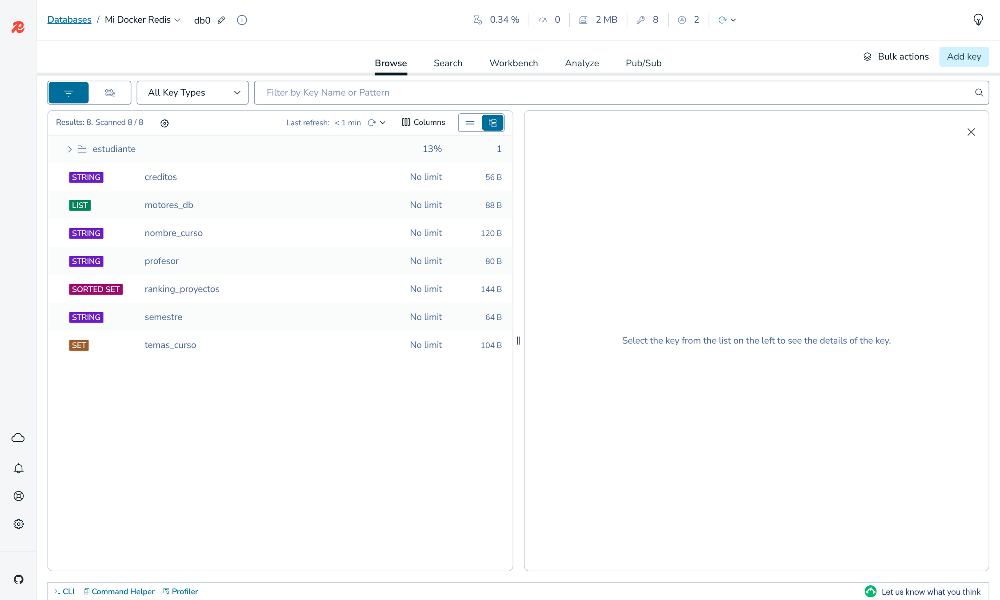
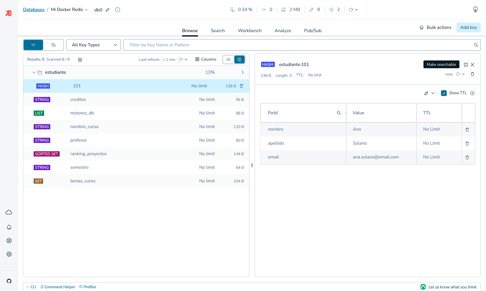
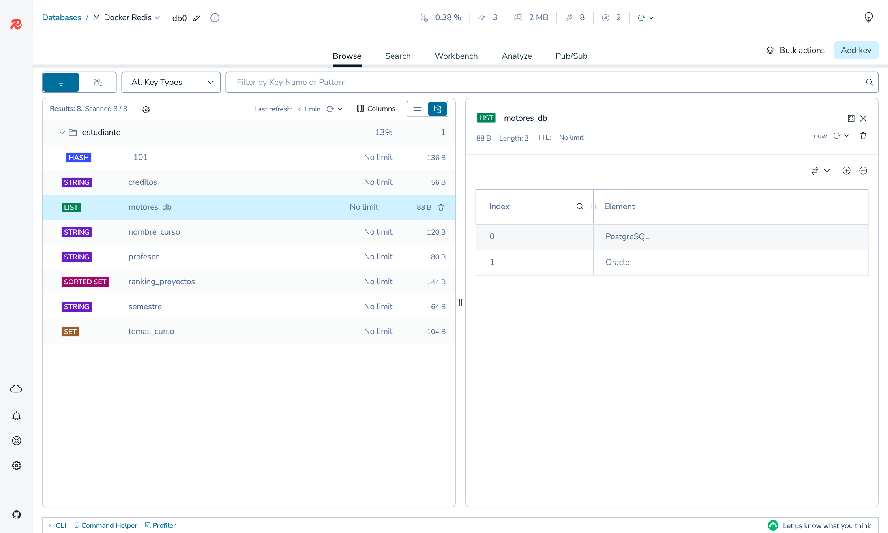
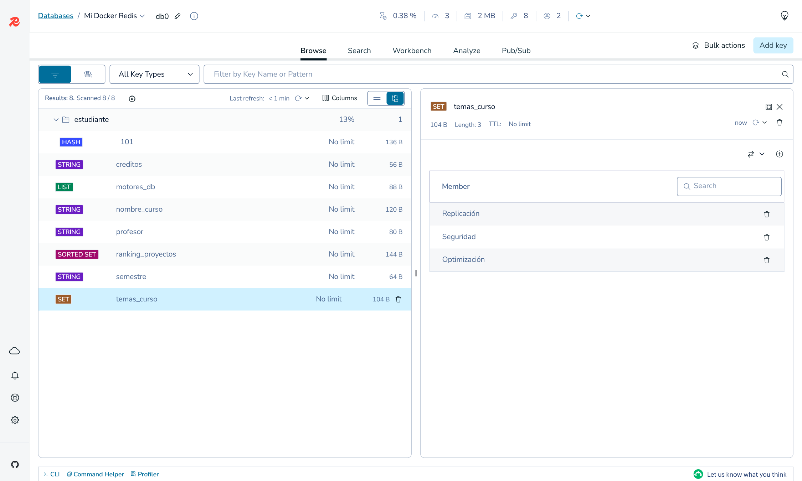
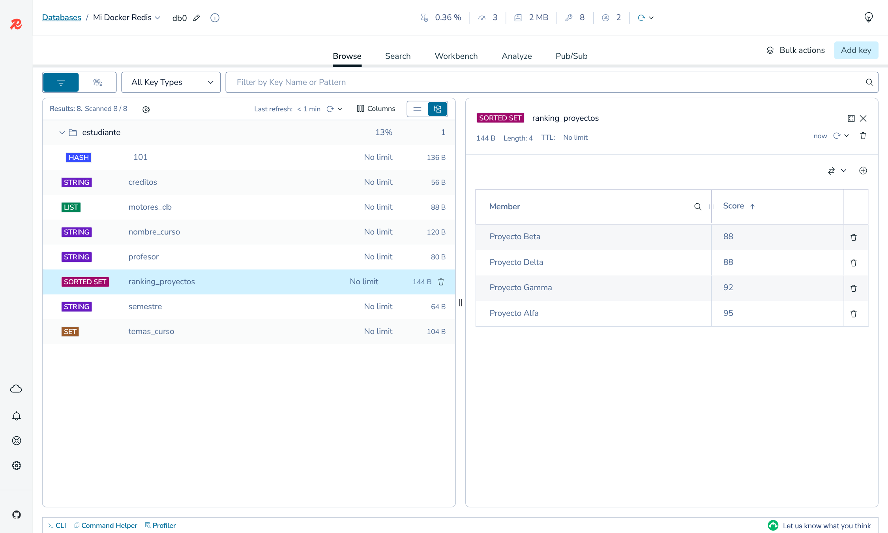
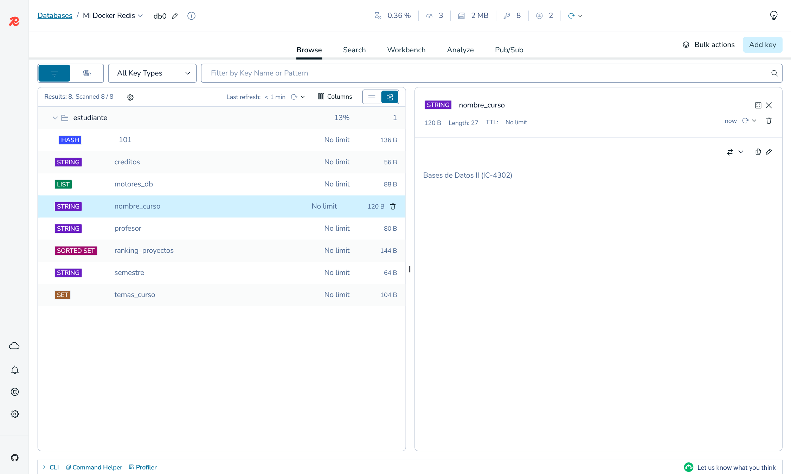

# Práctica Redis

Bases de Datos II, prof. Kenneth Obando Rodríguez
Integrantes: Fabián Sánchez, Santiago Villarreal

## Ambiente

Redis corriendo en Docker con la imagen oficial:

```
docker pull redis
docker run --name mi-redis -d -p 6379:6379 redis
docker ps
docker exec -it mi-redis redis-cli
```

Hicimos todos los ejercicios de cada sección. Todos los comandos están también en `comandos.redis`.

## 6.1 Strings

**1.** Establece la clave nombre_curso con el valor "Bases de Datos II".

```
127.0.0.1:6379> SET nombre_curso "Bases de Datos II"
```

Salida:

```
OK
```

**2.** Obtén el valor de la clave nombre_curso.

```
127.0.0.1:6379> GET nombre_curso
```

Salida:

```
"Bases de Datos II"
```

**3.** Establece la clave creditos con el valor 3.

```
127.0.0.1:6379> SET creditos 3
```

Salida:

```
OK
```

**4.** Incrementa el valor de creditos en 1.

```
127.0.0.1:6379> INCR creditos
```

Salida:

```
(integer) 4
```

**5.** Obtén el valor actual de creditos.

```
127.0.0.1:6379> GET creditos
```

Salida:

```
"4"
```

El resultado es 4.

**6.** Decrementa el valor de creditos en 1.

```
127.0.0.1:6379> DECR creditos
```

Salida:

```
(integer) 3
```

**7.** Obtén el valor actual de creditos.

```
127.0.0.1:6379> GET creditos
```

Salida:

```
"3"
```

Vuelve a 3.

**8.** Añade el texto " (IC-4302)" al final del valor de nombre_curso.

```
127.0.0.1:6379> APPEND nombre_curso " (IC-4302)"
```

Salida:

```
(integer) 27
```

**9.** Obtén el nuevo valor de nombre_curso.

```
127.0.0.1:6379> GET nombre_curso
```

Salida:

```
"Bases de Datos II (IC-4302)"
```

**10.** Obtén la longitud del valor almacenado en nombre_curso.

```
127.0.0.1:6379> STRLEN nombre_curso
```

Salida:

```
(integer) 27
```

**11.** Establece profesor con valor "Kenneth Obando" y semestre con valor "I" a la vez.

```
127.0.0.1:6379> MSET profesor "Kenneth Obando" semestre "I"
```

Salida:

```
OK
```

**12.** Obtén los valores de profesor y semestre en un solo comando.

```
127.0.0.1:6379> MGET profesor semestre
```

Salida:

```
1) "Kenneth Obando"
2) "I"
```


## 6.2 Lists

**1.** Añade "Oracle", "PostgreSQL", "SQL Server" al inicio (izquierda) de motores_db.

```
127.0.0.1:6379> LPUSH motores_db "Oracle" "PostgreSQL" "SQL Server"
```

Salida:

```
(integer) 3
```

**2.** Añade "MySQL" al final (derecha) de motores_db.

```
127.0.0.1:6379> RPUSH motores_db "MySQL"
```

Salida:

```
(integer) 4
```

**3.** Obtén todos los elementos de motores_db.

```
127.0.0.1:6379> LRANGE motores_db 0 -1
```

Salida:

```
1) "SQL Server"
2) "PostgreSQL"
3) "Oracle"
4) "MySQL"
```

**4.** Obtén el primer elemento (índice 0).

```
127.0.0.1:6379> LINDEX motores_db 0
```

Salida:

```
"SQL Server"
```

**5.** Obtén los elementos del índice 1 al 2.

```
127.0.0.1:6379> LRANGE motores_db 1 2
```

Salida:

```
1) "PostgreSQL"
2) "Oracle"
```

**6.** Obtén y elimina el primer elemento (izquierda).

```
127.0.0.1:6379> LPOP motores_db
```

Salida:

```
"SQL Server"
```

Salió "SQL Server". Como LPUSH mete cada elemento por la izquierda, el último que entró ("SQL Server") quedó de primero.

**7.** Obtén y elimina el último elemento (derecha).

```
127.0.0.1:6379> RPOP motores_db
```

Salida:

```
"MySQL"
```

Salió "MySQL".

**8.** Obtén la longitud actual de motores_db.

```
127.0.0.1:6379> LLEN motores_db
```

Salida:

```
(integer) 2
```

**9.** Obtén los elementos restantes.

```
127.0.0.1:6379> LRANGE motores_db 0 -1
```

Salida:

```
1) "PostgreSQL"
2) "Oracle"
```


## 6.3 Sets

**1.** Añade "Transacciones", "Replicación", "Seguridad" al set temas_curso.

```
127.0.0.1:6379> SADD temas_curso "Transacciones" "Replicación" "Seguridad"
```

Salida:

```
(integer) 3
```

**2.** Intenta añadir "Replicación" de nuevo.

```
127.0.0.1:6379> SADD temas_curso "Replicación"
```

Salida:

```
(integer) 0
```

Devuelve 0 porque el elemento ya estaba; un set no guarda repetidos.

**3.** Añade "Optimización".

```
127.0.0.1:6379> SADD temas_curso "Optimización"
```

Salida:

```
(integer) 1
```

**4.** Obtén todos los miembros de temas_curso.

```
127.0.0.1:6379> SMEMBERS temas_curso
```

Salida:

```
1) "Optimizaci\xc3\xb3n"
2) "Seguridad"
3) "Transacciones"
4) "Replicaci\xc3\xb3n"
```

redis-cli muestra las tildes como bytes (\xc3\xb3). Con `redis-cli --raw` se ven bien.

**5.** Verifica si "Seguridad" es miembro.

```
127.0.0.1:6379> SISMEMBER temas_curso "Seguridad"
```

Salida:

```
(integer) 1
```

**6.** Verifica si "Big Data" es miembro.

```
127.0.0.1:6379> SISMEMBER temas_curso "Big Data"
```

Salida:

```
(integer) 0
```

**7.** Elimina "Transacciones".

```
127.0.0.1:6379> SREM temas_curso "Transacciones"
```

Salida:

```
(integer) 1
```

**8.** Obtén la cardinalidad de temas_curso.

```
127.0.0.1:6379> SCARD temas_curso
```

Salida:

```
(integer) 3
```

**9.** Obtén los miembros restantes.

```
127.0.0.1:6379> SMEMBERS temas_curso
```

Salida:

```
1) "Optimizaci\xc3\xb3n"
2) "Seguridad"
3) "Replicaci\xc3\xb3n"
```


## 6.4 Hashes

**1.** Crea estudiante:101 con nombre "Ana", apellido "Solano" y carnet "202300101".

```
127.0.0.1:6379> HSET estudiante:101 nombre "Ana" apellido "Solano" carnet "202300101"
```

Salida:

```
(integer) 3
```

**2.** Obtén el campo nombre.

```
127.0.0.1:6379> HGET estudiante:101 nombre
```

Salida:

```
"Ana"
```

**3.** Obtén todos los campos y valores.

```
127.0.0.1:6379> HGETALL estudiante:101
```

Salida:

```
1) "nombre"
2) "Ana"
3) "apellido"
4) "Solano"
5) "carnet"
6) "202300101"
```

**4.** Establece email a "ana.solano@email.com".

```
127.0.0.1:6379> HSET estudiante:101 email "ana.solano@email.com"
```

Salida:

```
(integer) 1
```

**5.** Obtén solo los nombres de los campos.

```
127.0.0.1:6379> HKEYS estudiante:101
```

Salida:

```
1) "nombre"
2) "apellido"
3) "carnet"
4) "email"
```

**6.** Obtén solo los valores.

```
127.0.0.1:6379> HVALS estudiante:101
```

Salida:

```
1) "Ana"
2) "Solano"
3) "202300101"
4) "ana.solano@email.com"
```

**7.** Elimina el campo carnet.

```
127.0.0.1:6379> HDEL estudiante:101 carnet
```

Salida:

```
(integer) 1
```

**8.** Obtén el número de campos.

```
127.0.0.1:6379> HLEN estudiante:101
```

Salida:

```
(integer) 3
```

**9.** Obtén los campos y valores restantes.

```
127.0.0.1:6379> HGETALL estudiante:101
```

Salida:

```
1) "nombre"
2) "Ana"
3) "apellido"
4) "Solano"
5) "email"
6) "ana.solano@email.com"
```


## 6.5 Sorted Sets

**1.** Añade "Proyecto Alfa" 95, "Proyecto Beta" 88 y "Proyecto Gamma" 92 a ranking_proyectos.

```
127.0.0.1:6379> ZADD ranking_proyectos 95 "Proyecto Alfa" 88 "Proyecto Beta" 92 "Proyecto Gamma"
```

Salida:

```
(integer) 3
```

**2.** Añade "Proyecto Delta" con score 88.

```
127.0.0.1:6379> ZADD ranking_proyectos 88 "Proyecto Delta"
```

Salida:

```
(integer) 1
```

**3.** Obtén todos los miembros de menor a mayor score, con scores.

```
127.0.0.1:6379> ZRANGE ranking_proyectos 0 -1 WITHSCORES
```

Salida:

```
1) "Proyecto Beta"
2) "88"
3) "Proyecto Delta"
4) "88"
5) "Proyecto Gamma"
6) "92"
7) "Proyecto Alfa"
8) "95"
```

Beta y Delta empatan en 88; Redis desempata por orden alfabético del miembro.

**4.** Obtén los miembros de mayor a menor, con scores.

```
127.0.0.1:6379> ZREVRANGE ranking_proyectos 0 -1 WITHSCORES
```

Salida:

```
1) "Proyecto Alfa"
2) "95"
3) "Proyecto Gamma"
4) "92"
5) "Proyecto Delta"
6) "88"
7) "Proyecto Beta"
8) "88"
```

**5.** Obtén los dos proyectos con score más alto.

```
127.0.0.1:6379> ZREVRANGE ranking_proyectos 0 1 WITHSCORES
```

Salida:

```
1) "Proyecto Alfa"
2) "95"
3) "Proyecto Gamma"
4) "92"
```

**6.** Obtén el ranking (base 0) de "Proyecto Gamma".

```
127.0.0.1:6379> ZRANK ranking_proyectos "Proyecto Gamma"
```

Salida:

```
(integer) 2
```

Devuelve 2: Beta (0), Delta (1), Gamma (2).

**7.** Obtén el score de "Proyecto Alfa".

```
127.0.0.1:6379> ZSCORE ranking_proyectos "Proyecto Alfa"
```

Salida:

```
"95"
```

**8.** Obtén la cantidad de miembros.

```
127.0.0.1:6379> ZCARD ranking_proyectos
```

Salida:

```
(integer) 4
```


## 6.6 Administración de claves

**1.** Lista todas las claves.

```
127.0.0.1:6379> KEYS *
```

Salida:

```
1) "nombre_curso"
2) "ranking_proyectos"
3) "temas_curso"
4) "semestre"
5) "motores_db"
6) "estudiante:101"
7) "creditos"
8) "profesor"
```

**2.** Verifica si nombre_curso existe.

```
127.0.0.1:6379> EXISTS nombre_curso
```

Salida:

```
(integer) 1
```

**3.** Verifica si profesor_auxiliar existe.

```
127.0.0.1:6379> EXISTS profesor_auxiliar
```

Salida:

```
(integer) 0
```

**4.** Elimina la clave creditos.

```
127.0.0.1:6379> DEL creditos
```

Salida:

```
(integer) 1
```

**5.** Verifica de nuevo si creditos existe.

```
127.0.0.1:6379> EXISTS creditos
```

Salida:

```
(integer) 0
```

**6.** Obtén el tipo de motores_db.

```
127.0.0.1:6379> TYPE motores_db
```

Salida:

```
list
```

**7.** Obtén el tipo de estudiante:101.

```
127.0.0.1:6379> TYPE estudiante:101
```

Salida:

```
hash
```

**8.** Pon expiración de 60 segundos a temas_curso.

```
127.0.0.1:6379> EXPIRE temas_curso 60
```

Salida:

```
(integer) 1
```

**9.** Consulta el tiempo restante de temas_curso.

```
127.0.0.1:6379> TTL temas_curso
```

Salida:

```
(integer) 60
```

Ejecutado varias veces baja: 60, 57, 52...

**10.** Consulta el TTL de nombre_curso (no tiene expiración).

```
127.0.0.1:6379> TTL nombre_curso
```

Salida:

```
(integer) -1
```

-1 significa que la clave existe pero no tiene expiración.

**11.** Consulta el TTL de creditos (no existe).

```
127.0.0.1:6379> TTL creditos
```

Salida:

```
(integer) -2
```

-2 significa que la clave no existe.

**12.** Elimina todas las claves de la base actual.

```
127.0.0.1:6379> FLUSHDB
```

Salida:

```
OK
```

**13.** Verifica que no queden claves.

```
127.0.0.1:6379> KEYS *
```

Salida:

```
(empty array)
```


## Capturas de RedisInsight

Conectamos RedisInsight a la misma instancia (host del contenedor, puerto 6379) y tomamos las capturas después de correr las secciones 6.1 a 6.5, antes de la administración de claves.

Vista general de las 8 claves:



Hash estudiante:101 después de agregar email y borrar carnet (6.4):



Lista motores_db después de LPOP y RPOP (6.2):



Set temas_curso después de SREM (6.3):



Sorted set ranking_proyectos con los cuatro proyectos (6.5):



String nombre_curso después del APPEND (6.1):


